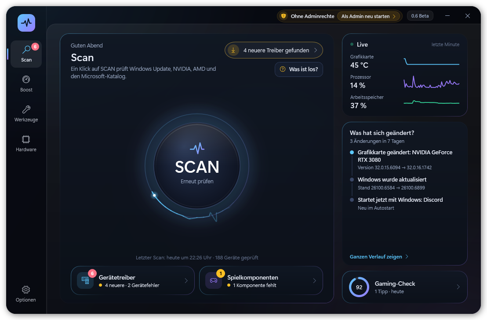

# PulsRig – Quelltext

Windows-Programm für Treiber, Boost, Hardware-Prüfungen und Werkzeuge: sucht neuere Treiber (Windows Update, NVIDIA, AMD, Microsoft-Katalog), schafft vor dem Spielen Platz, misst Temperaturen, testet die Hardware unter Last, vergleicht Benchmarks über die Zeit und erklärt Abstürze.

- **Setup und Updates:** [PulsRig/PulsRig](https://github.com/PulsRig/PulsRig) · **Webseite:** https://pulsrig.github.io/PulsRig/
- **Kontakt:** pulsrig.hilfe@gmail.com

## Aufbau

PowerShell 5.1 mit WPF-Oberfläche (`PulsRig.ps1`, `PulsRig.xaml`), dazu Teile in C#, die zur Laufzeit übersetzt werden (Last und Benchmark, Temperatur, Aufzeichnung, Controller und Maus). `PulsRig-Start.cs` ist die Hülle `PulsRig.exe`, die alle Skripte eingebettet trägt und den Helfer neben der Uhr enthält.

## Aus dem Quelltext starten

- Windows 10 oder 11, PowerShell 5.1
- `PulsRig.bat` starten (fragt nach Adminrechten; ohne sie läuft es eingeschränkt)
- Prüfen: `powershell -NoProfile -ExecutionPolicy Bypass -File PulsRig-Tests.ps1`
- Probelauf mit Bildschirmfotos: `powershell -NoProfile -ExecutionPolicy Bypass -File PulsRig.ps1 -Snapshot <Ordner>`
- Setup bauen: `PulsRig-Paket.ps1` (braucht Inno Setup 7)

Wichtig beim Ändern: Alle `.ps1`-Dateien bleiben **UTF-8 mit BOM**, sonst gehen die Umlaute kaputt.

## Lizenz

PulsRig steht unter der **GNU General Public License 3.0** (siehe `LICENSE`). Die Bausteine im Ordner `Sensoren` (LibreHardwareMonitor, MPL-2.0; .NET-Pakete, MIT) gehören ihren Urhebern und stehen unter ihren eigenen Lizenzen, siehe `Sensoren/LIZENZEN.txt`. Den Treiber PawnIO liefert PulsRig nicht mit; er wird nur auf Wunsch über sein offizielles Setup installiert.

---

**English:** Source code of PulsRig, a Windows tool for drivers, game boost, hardware checks and utilities (PowerShell 5.1 + WPF, parts in C#). The interface is German with an English translation. Licensed under GPL-3.0; third-party components in `Sensoren/` keep their own licenses. Releases: [PulsRig/PulsRig](https://github.com/PulsRig/PulsRig).
